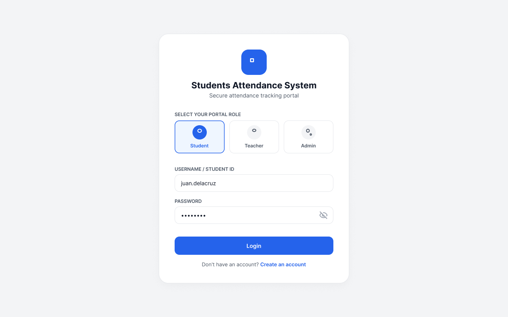
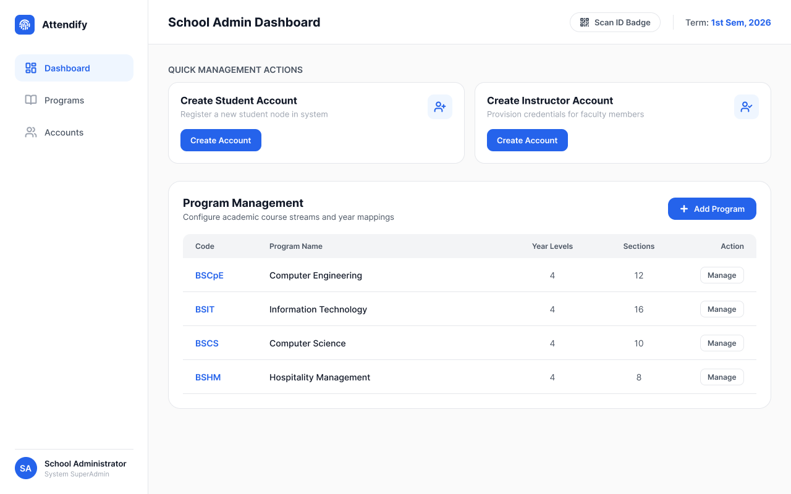
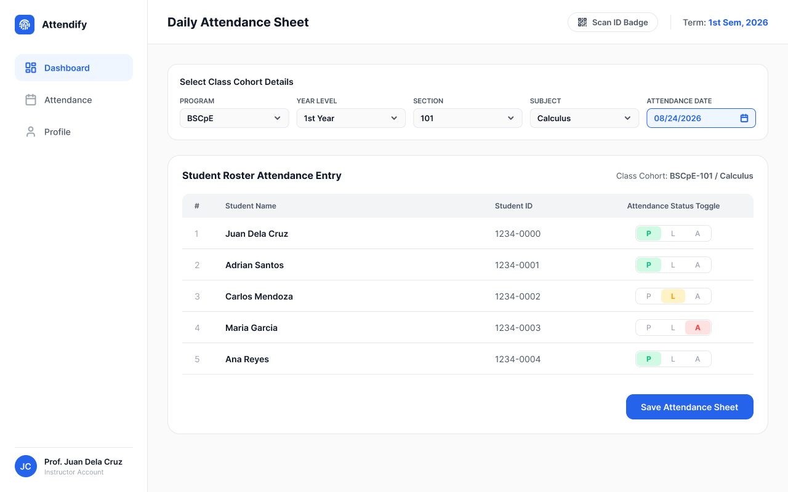
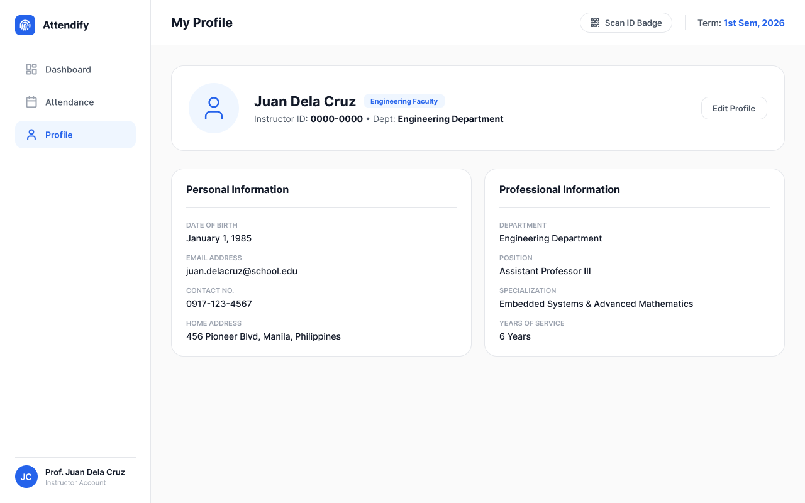
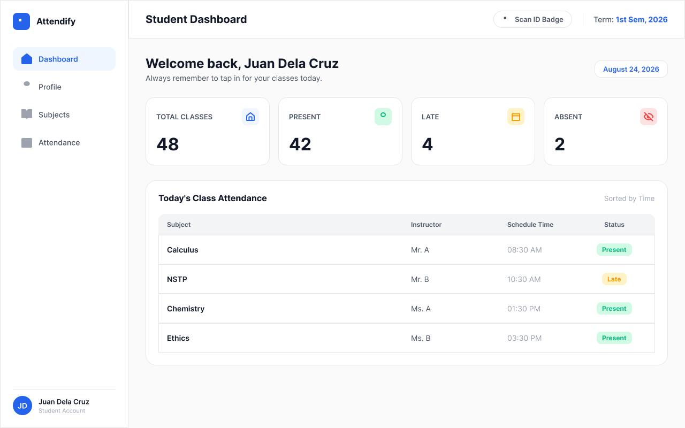
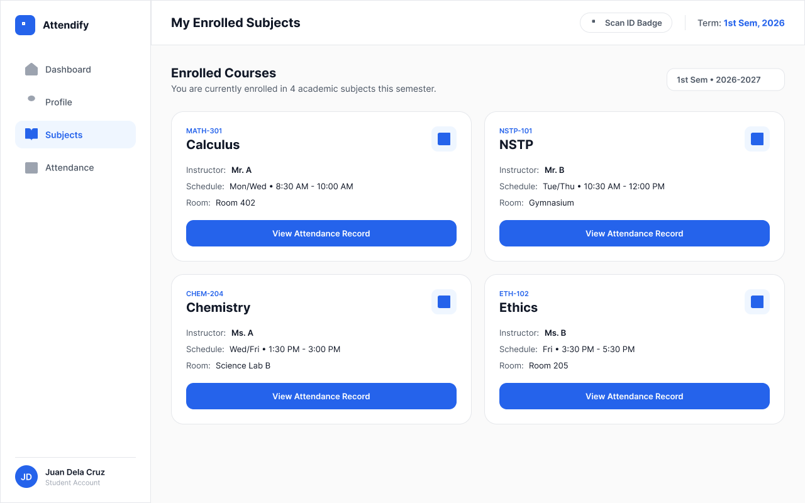
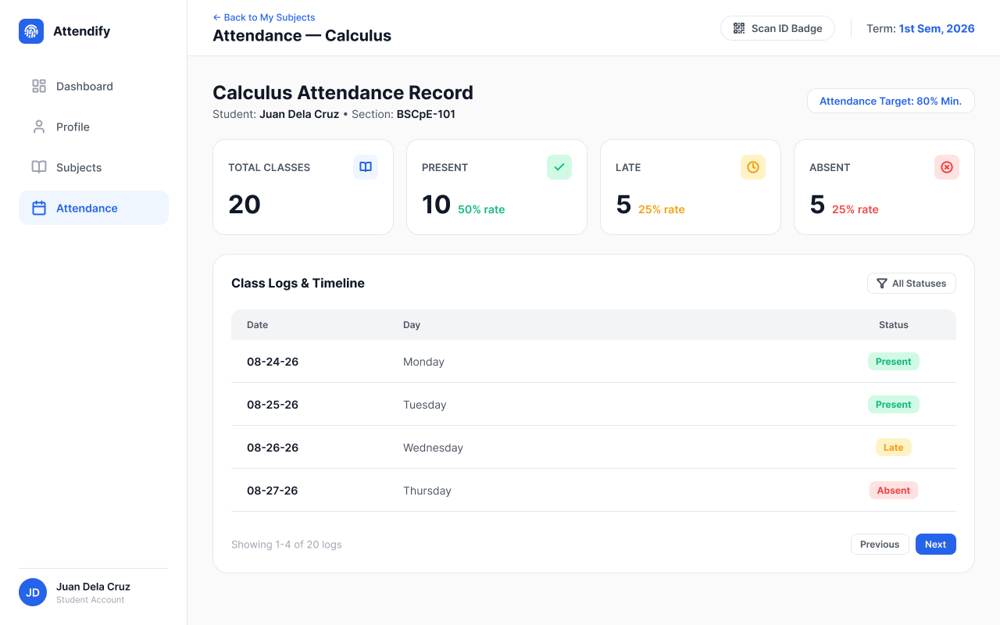
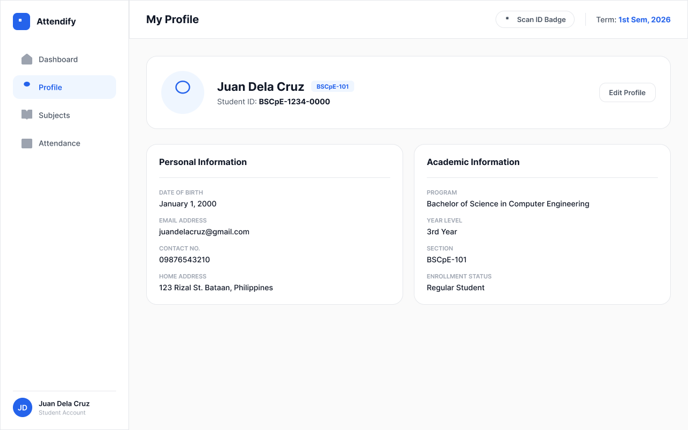

# 🎓 ClassPulse — Student Attendance System

ClassPulse (by XI Labs) is a MERN-stack web application for secure, role-based academic attendance tracking, with **QR code check-in**, excuse letters, term-based reports and an audit log. This project is developed for Test and Quality Assurance (TQA) to demonstrate robust UI/UX implementation, systemic routing, and API integration.

## 🎨 UI/UX Design System & Screenshots

Our team finalized high-fidelity interface prototypes for all three user roles: **Admin**, **Instructor**, and **Student**.

### 🔐 Multi-Role Authentication
| Portal Login (`web-login.png`) |
| :---: |
|  |

---

### 👨‍💼 School Administrator View
| School Admin Dashboard (`web-admin-dashboard.png`) |
| :---: |
|  |

---

### 👨‍🏫 Instructor / Teacher View
| Daily Attendance Sheet (`web-instructor-dashboard.png`) | Instructor Profile (`web-instructor-profile.png`) |
| :---: | :---: |
|  |  |

---

### 👨‍🎓 Student View
| Student Dashboard (`web-student-dashboard.png`) | Enrolled Subjects (`web-my-subjects.png`) |
| :---: | :---: |
|  |  |

| Attendance Timeline (`web-attendance-detail.png`) | Student Profile (`web-student-profile.png`) |
| :---: | :---: |
|  |  |


**🚀 Live Front-End Demo:** [https://tqa-student-attendance-system.vercel.app](https://tqa-student-attendance-system.vercel.app)

---

## 🛠️ Technology Stack

**Front-End (Client)**
* **Framework:** React 19 + Vite
* **Styling:** Tailwind CSS v4
* **Routing:** React Router DOM v7
* **HTTP Client:** Axios
* **QR Codes:** `qrcode.react` (generate) and `html5-qrcode` (camera scanning)
* **Deployment:** Vercel (Configured with `vercel.json` for SPA routing)

**Back-End (Server)**
* **Runtime:** Node.js
* **Framework:** Express.js
* **Database:** MongoDB (Mongoose ORM)
* **Authentication:** JSON Web Tokens (JWT, 1-day sessions) & bcryptjs
* **Security:** helmet (security headers), express-rate-limit (login / sign-up / check-in limits)
* **QR Signing:** Node `crypto` HMAC (rotating 15-second class codes, signed student IDs)
* **Environment:** dotenv, cors

---

## 🌟 System Portals & Features

1. **Student Portal:**
   * **QR Check-in page** — scan the classroom QR with the phone camera, or type the 6-character code.
   * **Personal QR ID** that an instructor can scan.
   * **Excuse letters**: file one for an absence or late mark and track its approval.
   * Filter attendance by **academic term**.
   * Dynamic attendance dashboard with overall percentage tracking.
   * Low-attendance target warnings (<80%).
   * Privacy-toggled user profiles masking sensitive contact information.
   * Editable profiles for every role: profile picture (cropped and resized in the browser), email, contact number and address, from the profile page or the sidebar.
   * Enrolled subjects overview with schedule and room assignments.

2. **Instructor Portal:**
   * **QR check-in sessions** — project a rotating QR code; students scan it to mark themselves Present/Late (see below).
   * **Scan student QR IDs** with the device camera straight into the attendance sheet.
   * Daily attendance sheet management with Present (P), Late (L), Absent (A) and Excused (E) toggles, "all present / all absent" shortcuts.
   * CSV export of the full attendance matrix per subject (dates × students, with totals and rate).
   * **Excuse Letters** inbox: approve (marks the day EXCUSED) or reject with a note.
   * **Reports**: class average, turnout chart per meeting, and the list of students below 80%, per term.
   * **Printable QR ID cards** for students without a phone.
   * Roster filtering by Program, Year Level, Section, and Subject.
   * Instructor schedule and assigned cohort tracking.

3. **Admin Portal:**
   * High-level system overview (Active Programs, Total Instructors, Scheduled Classes).
   * Account Management Panel for creating, editing, and deactivating user accounts.
   * Program Management for configuring academic course streams.
   * **Subjects & Classes** page to create, edit and delete subjects and assign instructors, sections, schedules and rooms.
   * **Academic Terms** (semesters); the current term shows in everyone's sidebar.
   * **Import Students** from a CSV file, with optional enrollment and one-time temporary passwords.
   * **Approve or reject account requests**: students can't create accounts on their own. The sign-up page only sends a request (or, with `SIGNUP_MODE=off`, explains that the registrar creates accounts); the admin approves it in Accounts and enrolls the student.
   * **Official student numbers only**: student IDs must match the school format `YYYY-NNNNN` (e.g. 2026-00123) on sign-up, Create New User and CSV import. Set `STUDENT_ID_PATTERN` in `.env` for another format. Existing accounts are not affected.
   * **Enroll a student directly** from Accounts (🎓 Enroll / Change class): pick a section and its subjects, no enrollment key needed.
   * **Reset a user's password** (temporary password, forced change at next login).
   * **Handle "Forgot password" requests**: users send a request from the login page; it appears on the Dashboard and at the top of Accounts, where the admin resets or dismisses it.
   * **Reports** for all classes, **QR ID cards** per section, and an **Audit Log** of who changed what.

---

## 📂 Project Structure

This repository is organized as a monorepo, separating the front-end client and back-end server into distinct environments.

```text
TQA_studentAttendanceSystem/
├── client/                         # React/Vite Front-End
│   ├── src/
│   │   ├── components/             # Sidebar, QrScanner, RequireRole, Toast,
│   │   │                           # ChangePasswordModal, TermSelect, BrandLogo
│   │   ├── pages/
│   │   │   ├── Admin*.jsx          # Dashboard, Terms, Programs, Subjects, Accounts,
│   │   │   │                       # Import, Enrollment Keys, Audit
│   │   │   ├── Instructor*.jsx     # Dashboard, QR Session, Attendance Sheet, Excuses, Profile
│   │   │   ├── Student*.jsx        # Dashboard, QR Check-in, Subjects, Attendance, Profile
│   │   │   ├── Reports.jsx         # Shared by instructors and admins
│   │   │   └── IdCards.jsx         # Printable QR ID cards
│   │   ├── services/api.js         # Axios instance, JWT header, auto-logout on expiry
│   │   ├── utils/date.js           # Local date, time formatting, CSV export
│   │   ├── App.jsx                 # Routes + role-guarded layout
│   │   └── index.css               # Tailwind v4, focus ring, print styles
│   ├── package.json
│   ├── vite.config.js
│   └── vercel.json                 # SPA routing rules
│
└── server/                         # Node/Express Back-End
    ├── controllers/                # auth, program/subject, attendance + QR, term, excuse
    ├── middleware/                 # JWT auth, RBAC, privacy masking, rate limits
    ├── models/                     # User, Program, Subject, EnrollmentKey, Attendance,
    │                               # AttendanceSession, Term, ExcuseRequest, AuditLog
    ├── routes/                     # /auth, /academic, /attendance, /terms, /excuses
    ├── utils/                      # qr.js (signed codes), audit.js (audit log helper)
    ├── seed.js                     # Demo accounts: npm run seed
    ├── .env.example
    ├── package.json
    └── server.js                   # Express entry: helmet, CORS, routes
```

---

## 🚀 Running Locally

```bash
# Back-end
cd server
cp .env.example .env      # fill in MONGO_URI and JWT_SECRET
npm install
npm run seed              # optional: demo accounts + one class with 4 subjects
npm run dev               # http://localhost:5000

# Front-end (new terminal)
cd client
npm install
npm run dev               # http://localhost:5173
```

Set `VITE_API_BASE_URL` in `client/.env.local` if the API is not at `http://localhost:5000/api/v1`.

**Demo accounts** (after `npm run seed`, password `password123`): `ADMIN-01`, `INST-01`, and students `STU-001` to `STU-010`. Type the ID as the username and pick the matching role tab.

The seed also creates the **active academic term** for today's date (e.g. 1st Semester, AY 2026-2027) and class **DEMO-301** with 4 subjects, all taught by `INST-01`, and enrolls all 10 students in every subject: `TQA-DEMO` (Test and Quality Assurance), `WEB-DEMO` (Web Systems and Technologies), `DBMS-DEMO` (Database Management Systems) and `NET-DEMO` (Data Communications and Networking). Run `npm run seed -- --reset-passwords` if an existing demo account can't log in.

**First-time setup without the seed:** register the first **Admin** from the sign-up page (only allowed while no admin exists). Then, as that admin, create a term → instructors → programs → **Subjects & Classes** → import students or issue enrollment keys.

> 📸 The screenshots above show the original design. Newer pages (QR Check-in, Reports, Excuse Letters, Terms, Import, Audit Log, ID Cards) don't have screenshots yet.

---

## 📷 QR Code Attendance

There are two QR flows. Both write to the same `Attendance` collection as the manual sheet, so stats, the student timeline and the CSV export all include them.

### 1. Class QR (instructor shows, students scan)
1. Instructor opens **QR Check-in**, picks a subject, sets *Late after* (minutes) and *Close after* (minutes), and presses **Start**.
2. A QR code and a 6-character code appear. Both **change every 15 seconds** (HMAC-signed), so a photo sent to someone outside the room stops working within about 30 seconds. **Projector mode** shows it full-screen.
3. Students open **QR Check-in** on their phone and scan the code, or type the code if their camera doesn't work. The server checks that the student is enrolled in that subject and records `PRESENT`, or `LATE` once the late threshold has passed. Scanning twice does nothing.
4. The instructor sees check-ins appear live. **Close check-in** (or **Finalize** after the window times out) can mark everyone who didn't check in as `ABSENT`.

### 2. Student QR ID (students show, instructor scans)
* Each student has a permanent, signed QR ID under **QR Check-in → My QR ID**. The signature means nobody can make a valid code just by guessing a student's ID.
* On the **Attendance Sheet**, the instructor presses **Scan Student QR ID**, chooses *Present* or *Late*, and scans students one after another. Each scan is saved right away.

> **Camera access requires HTTPS** (or `localhost`). The Vercel deployment is HTTPS, so it works there. If you test from a phone over your LAN (`http://192.168...`), the camera is blocked by the browser; use the typed code instead.

### New API endpoints (`/api/v1/attendance`)
| Method | Path | Role | Purpose |
|---|---|---|---|
| POST | `/sessions` | Instructor/Admin | Start (or resume) today's QR session `{ subjectId, lateAfterMinutes, durationMinutes }` |
| GET | `/sessions/active` | Instructor/Admin | Open sessions (resume after refresh) |
| GET | `/sessions/:id` | Instructor/Admin | Live view: current code, QR payload, check-ins, roster size |
| POST | `/sessions/:id/close` | Instructor/Admin | Close; `{ markAbsent: true }` marks no-shows ABSENT |
| POST | `/check-in` | Student | `{ payload }`: scanned QR text or the typed 6-char code |
| GET | `/my-qr` | Student | Signed personal QR ID payload |
| POST | `/scan-student` | Instructor/Admin | `{ subjectId, date, payload, status }`: mark a scanned student |
| GET | `/report?subjectId=&from=&to=` | Instructor/Admin | Attendance matrix for CSV export |
| GET | `/students?subjectId=` | Instructor/Admin | Roster for a subject (`?section=` still works) |

Also new: `PUT` / `DELETE /api/v1/academic/subjects/:id` (Admin).

### More endpoints
| Method | Path | Role | Purpose |
|---|---|---|---|
| GET | `/attendance/summary?termId=` | Instructor/Admin | One summary per class: average rate, meetings, students below 80% |
| GET | `/attendance/id-cards?subjectId=` or `?section=` | Instructor/Admin | Signed QR IDs for printing |
| GET/POST | `/terms` | All / Admin | List terms / create a term |
| PUT/DELETE | `/terms/:id` | Admin | Edit, make current, delete |
| POST | `/excuses` | Student | File an excuse letter `{ subjectId, date, reason }` |
| GET | `/excuses/mine` | Student | Own excuse letters |
| GET | `/excuses/review?status=` | Instructor/Admin | Letters for own classes |
| PATCH | `/excuses/:id` | Instructor/Admin | `{ status: APPROVED or REJECTED, note }` |
| GET | `/auth/me` | Any | Own profile (unmasked), including the profile picture |
| PUT | `/auth/me` | Any | Update own `email`, `contactNo`, `address`, `photo` (JPG/PNG/WebP data URL under 250 KB; `''` removes it) |
| PUT | `/auth/me/password` | Any | Change own password |
| PUT | `/auth/users/:id/password` | Admin | Reset to a temporary password (also closes that user's reset requests) |
| GET | `/auth/signup-mode` | Public | `{ mode: 'approval' \| 'off', needsFirstAdmin, studentIdExample }` for the sign-up page |
| GET | `/auth/account-requests` | Admin | Student sign-ups waiting for approval |
| PATCH | `/auth/account-requests/:id/approve` | Admin | Let the student log in |
| PATCH | `/auth/account-requests/:id/reject` | Admin | Keep the account blocked (record kept) |
| POST | `/auth/forgot-password` | Public | Request a reset `{ username, email, note? }`; same reply whether or not the account exists; 5 per hour per network |
| GET | `/auth/reset-requests?status=` | Admin | Pending (default), RESOLVED, DISMISSED or ALL requests |
| PATCH | `/auth/reset-requests/:id/dismiss` | Admin | Close a request without resetting |
| POST | `/auth/users/bulk` | Admin | Import students `{ students, enrollment? }` |
| GET | `/auth/audit-logs?action=` | Admin | Latest audit entries |

`my-stats` and `report` also accept `?termId=` (or `?from=&to=`).

### New environment variables (`server/.env`)
```
QR_SECRET=                      # optional, falls back to JWT_SECRET
SCHOOL_TIMEZONE=Asia/Manila
JWT_EXPIRES_IN=1d               # how long a login lasts
CLIENT_URL=https://your-app.vercel.app   # comma-separate several sites
ALLOW_VERCEL_PREVIEWS=false     # true = also allow *.vercel.app preview URLs
```

### New client dependencies
`qrcode.react` (renders QR codes) and `html5-qrcode` (camera scanning). Server: `helmet` and `express-rate-limit`. Run `npm install` in **both** `client/` and `server/` after pulling.

---

## 🔧 Fixes included with the QR update

| Area | Problem | Fix |
|---|---|---|
| Security | Anyone could register as **ADMIN** or **INSTRUCTOR** from the public sign-up page | Staff accounts can only be created by a logged-in admin (the very first admin on an empty database is still allowed) |
| Security | Instructors could read/write attendance for **any** subject | Instructors can only manage subjects assigned to them; they only see their own classes |
| Security | Deactivated or deleted accounts kept working until the 30-day token expired | `protect` middleware rejects them immediately |
| Bug | `User` pre-save hook re-hashed the password on every save, locking users out after any profile/enrollment save | Hook returns early when the password hasn't changed |
| Bug | Empty sections fell back to listing **every student in the school** on the roster | Roster is built from students enrolled in the subject; empty means empty |
| Bug | Default attendance date used UTC, so it showed *yesterday* before 8 AM in PH | Local date on the client; `SCHOOL_TIMEZONE` on the server |
| UX | Portal pages were reachable when logged out / with the wrong role | `RequireRole` route guard redirects to login or the user's own dashboard |
| UX | "Scan Student Barcode / QR ID" buttons did nothing | Wired to the real scanner |
| Gap | No UI to create subjects | Admin **Subjects & Classes** page |
| Data | Only P/L/A | Added **EXCUSED** (not counted against the attendance rate) and a `method` field (MANUAL / QR_SESSION / QR_ID / AUTO_ABSENT) |

## 🛡️ Second round: security, privacy and UX

| Area | Problem | Fix |
|---|---|---|
| Security | Unlimited login attempts (password guessing) | 10 failed logins per 15 min per user + IP; limits on sign-up and check-in too |
| Security | No security headers | `helmet` (HSTS, no-sniff, frame protection, ...) |
| Security | Logins lasted 30 days | 1 day (`JWT_EXPIRES_IN`); the app logs out cleanly when it expires |
| Security | API accepted requests from **any** `*.vercel.app` site | Only `CLIENT_URL` origins (previews opt-in) |
| Security | No way to recover an account | "Forgot password?" request on the login page, admin-verified reset with forced change; users can change their own password |
| Accountability | No record of who changed attendance | **Audit log** for sheets, scans, sessions, excuses, accounts, subjects, terms |
| Privacy (RA 10173) | No privacy notice or consent at sign-up | Notice + required consent checkbox; consent time stored |
| UX | Browser `alert()` pop-ups | On-page toast messages |
| Accessibility (WCAG 2.2) | 10–11px text, no visible keyboard focus | Text sizes raised one step; focus ring on every control; 44px menu targets |
| UX | Sidebar covered phone screens | Collapsible menu on small screens |
| Gap | No semesters | **Academic terms** with per-term filters and reports |
| Gap | No excuse process | **Excuse letters** with instructor approval |
| Gap | No class-level insight | **Reports** with turnout chart and at-risk students |
| Gap | Students without phones | **Printable QR ID cards** |
| Gap | Accounts created one by one | **CSV import** of students |
| Branding | README said "Attendify", app said "ClassPulse" | ClassPulse by XI Labs everywhere |

**Not built yet:** parent/guardian notifications (needs an email or SMS provider), location/campus-Wi-Fi check for QR check-in, offline check-in, two-factor login.
